# Morrow

**A real-time, local-first workspace for projects, tasks and docs.** Kanban boards and lists, rich tasks, collaborative pages and role-based workspaces. Every change shows up instantly across tabs and teammates, and an MCP endpoint lets AI assistants work with your tasks.

Built with React + TanStack on the web, Hono + oRPC + PostgreSQL on the server, ElectricSQL + TanStack DB for sync and Yjs for collaborative editing.

  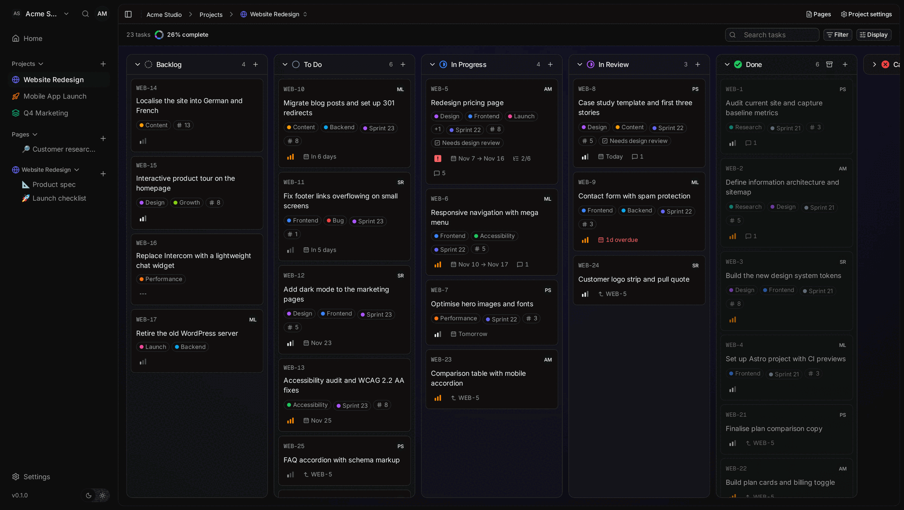

## Features

- **Projects and views:** Kanban board and grouped list views, custom workflows (columns), filters, sorting, progress, project icons, colours and backgrounds, and JSON import/export.
- **Tasks:** ticket ids (e.g. `WEB-5`), priority, assignees, start and due dates, recurring tasks, workspace labels, typed custom fields (single and multi choice, number, checkbox, text, date, URL), subtasks, relations, comments and a per-task history.
- **Collaborative pages:** a Tiptap editor on Yjs CRDTs with tables, task lists and code blocks, organised in a page tree per project or workspace, with offline editing.
- **Local-first sync:** ElectricSQL streams Postgres changes into TanStack DB collections persisted to in-browser SQLite, so reads are instant and writes are optimistic.
- **Workspaces and permissions:** email invitations, members, built-in and custom roles with per-permission toggles, and a workspace activity feed.
- **Search and keyboard:** a Ctrl+K command palette with full-text search across tasks and comments, and `G`-prefixed navigation hotkeys.
- **AI assistants:** an HTTP MCP endpoint authorised with OAuth, so assistants such as Claude can read and manage workspace tasks.
- **Accounts:** emailed sign-in codes, Google and GitHub OAuth, Turnstile CAPTCHA, rate limiting, disposable-email rejection, data export and account deletion.

## Screenshots

| Board | List view |
| :---: | :---: |
|  | 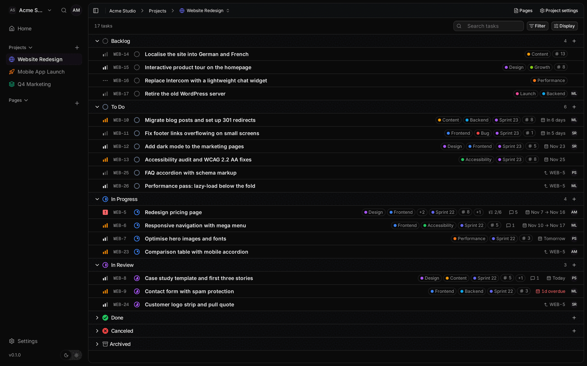 |
| **Task detail** | **Subtasks, comments and history** |
| 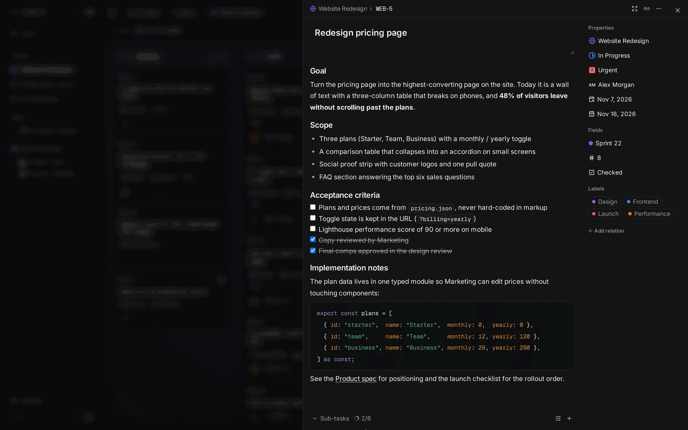 | 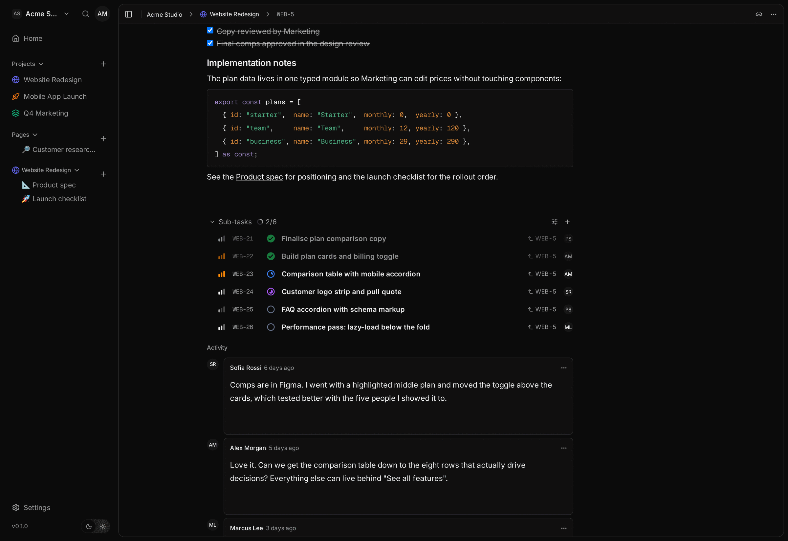 |
| **Collaborative page** | **Checklist page** |
| 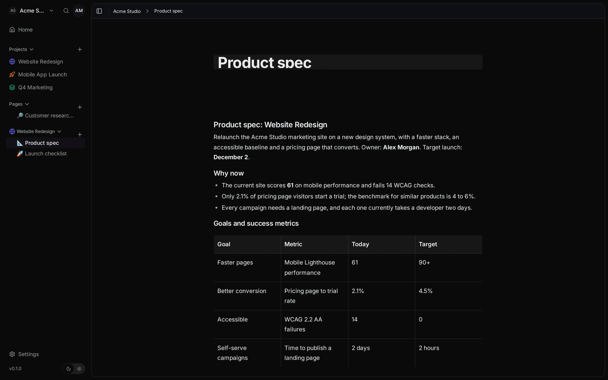 | 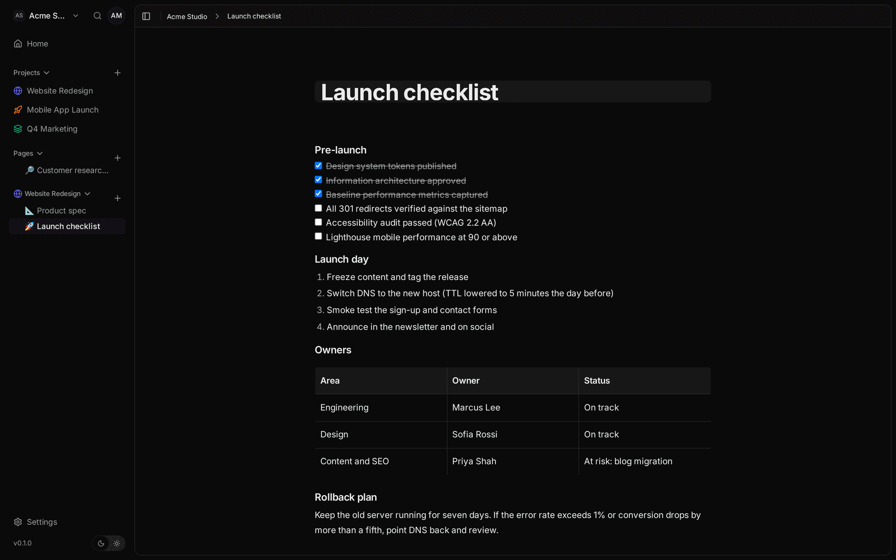 |
| **Command palette search** | **Custom fields** |
| 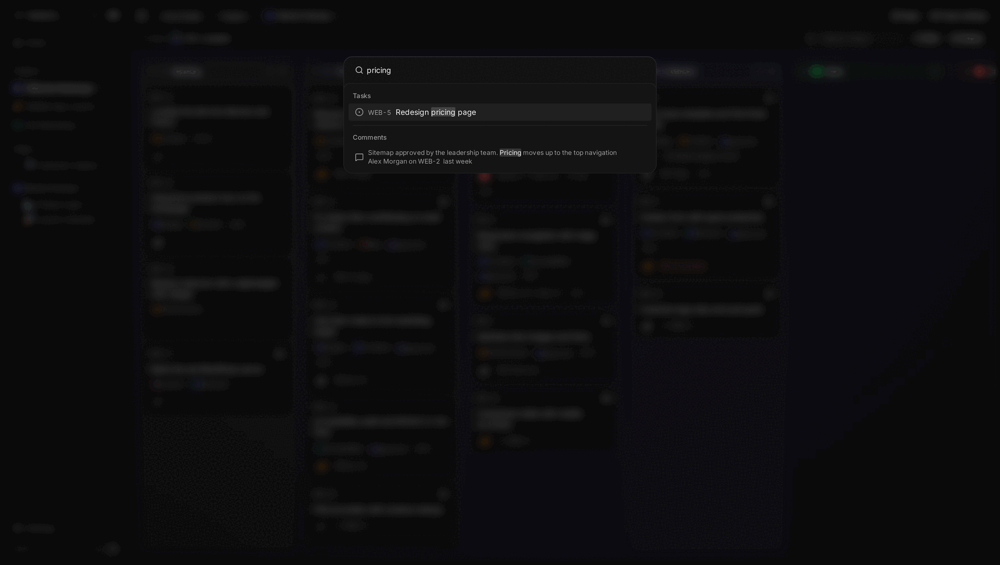 | 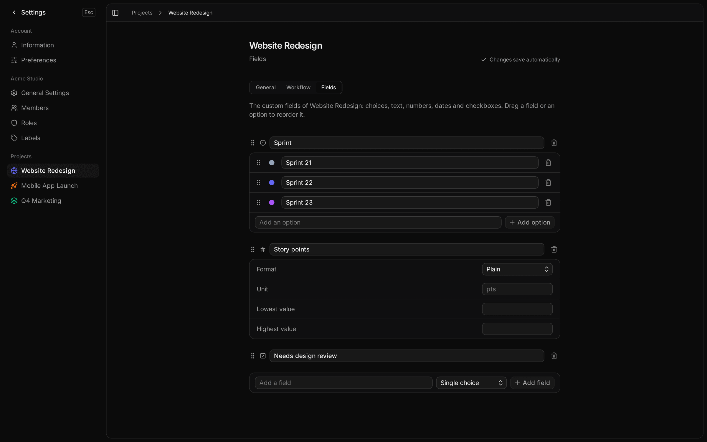 |
| **Roles and permissions** | **Members** |
| 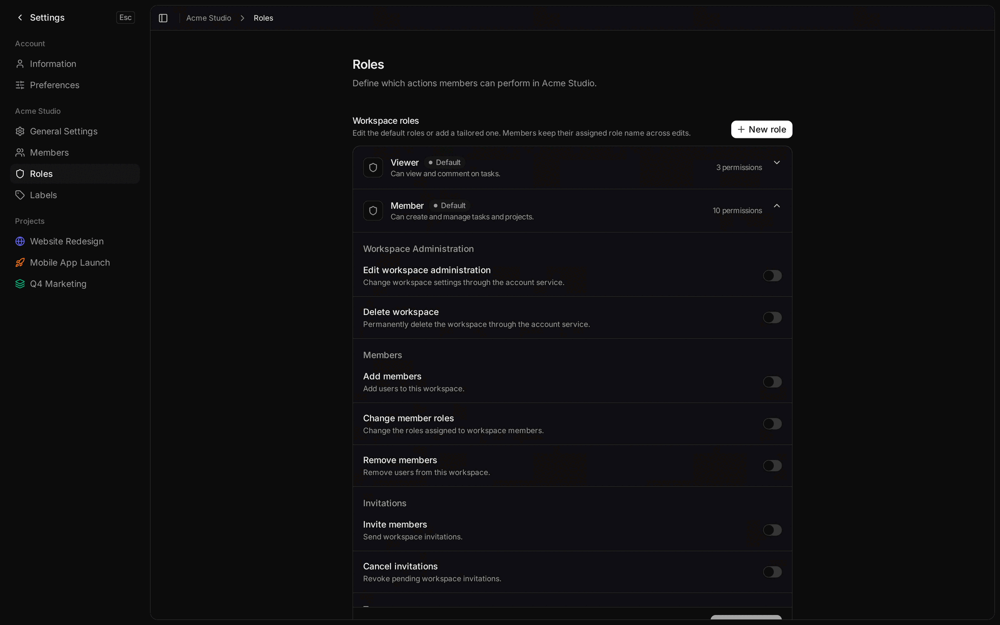 | 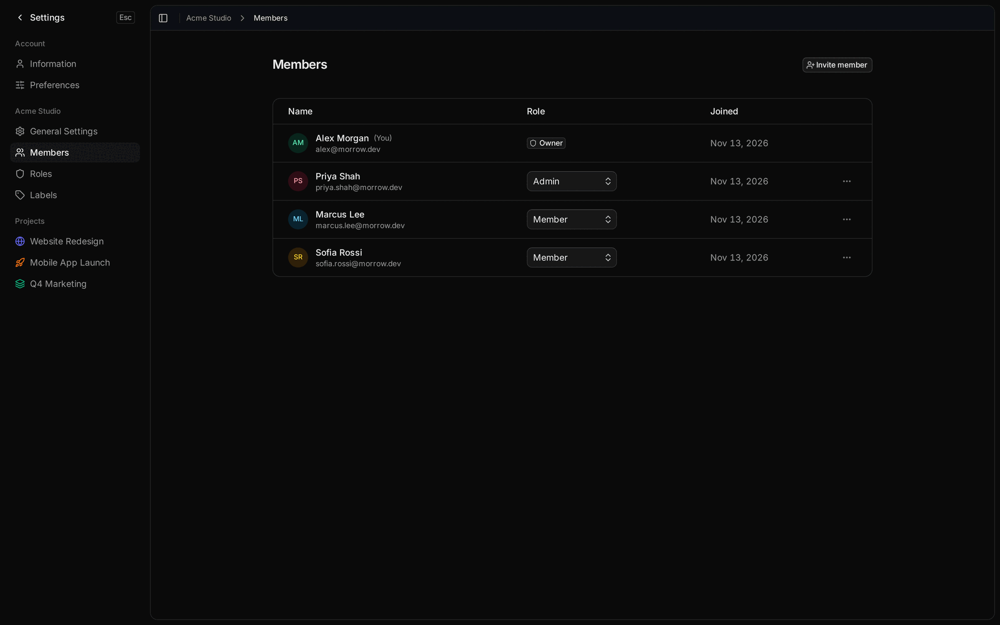 |
| **Workspace activity** | **Light mode** |
| 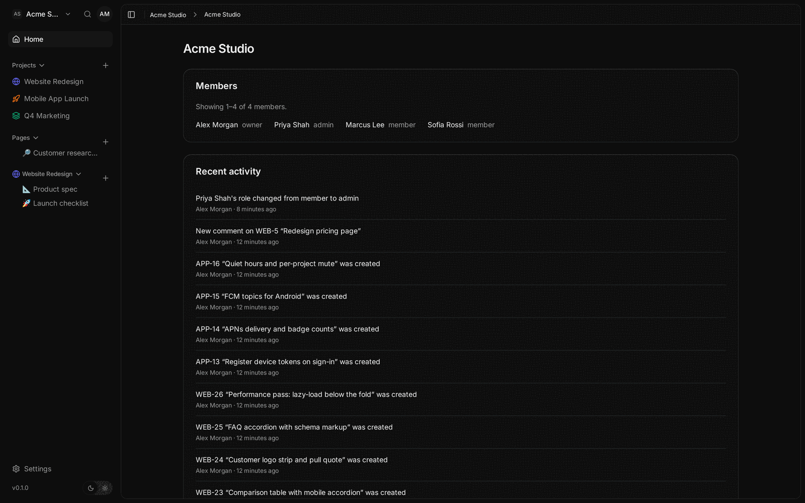 | 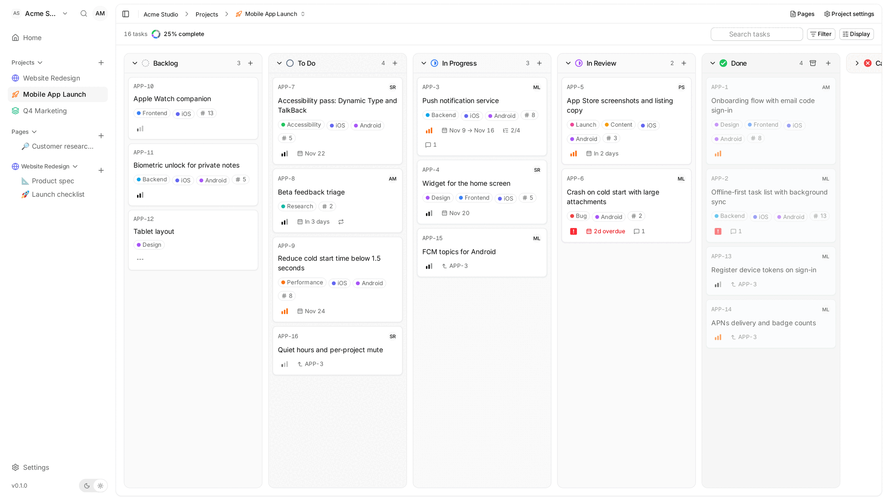 |

## Tech stack

| Area     | Stack                                                                                                   |
| -------- | ------------------------------------------------------------------------------------------------------- |
| Web      | React 19, TanStack Router, Query and DB, Tailwind CSS, Base UI, Tiptap, Yjs, wa-sqlite, i18next, Vite    |
| API      | Hono, oRPC, Better Auth (+ OAuth provider for MCP), Drizzle ORM, PostgreSQL, Model Context Protocol SDK  |
| Sync     | ElectricSQL (Postgres logical replication), TanStack DB, Durable Streams for Yjs documents              |
| Platform | Docker on Dokploy, S3-compatible storage (Cloudflare R2), Sentry, background worker                      |
| Quality  | TypeScript, Vitest, Playwright end-to-end tests, Vite+ lint/format, knip, commitlint, GitHub Actions     |

Architecture decisions are recorded in [docs/adr](docs/adr); domain terms in [CONTEXT.md](CONTEXT.md); sync design in [docs/sync.md](docs/sync.md).

## Develop

Needs Node.js 24.11+ (or 26+), pnpm 10.32.1 and Docker. `pnpm dev:services` starts a disposable PostgreSQL and a MinIO bucket for avatars (`compose.local.yml`) and applies migrations; `pnpm dev` runs it first.

1. Copy `.env.sample` to `.env` in the repository root and set `AUTH_SECRET` (`openssl rand -hex 32`, keep it stable) and your email in `ADMIN_EMAILS`. Every variable is declared in [`.env.schema`](.env.schema); `pnpm exec varlock load` validates your setup with secrets masked. A stale key in `.env` that the schema no longer declares (for example `DISCORD_CLIENT_ID`) fails validation: delete it.
2. `pnpm install && pnpm dev`, then open https://localhost:5443. Caddy serves the dev server over HTTP/2 (the sync long-polls need it) with a certificate from [mkcert](https://github.com/FiloSottile/mkcert): install it and run `mkcert -install` once (it needs `certutil` for Firefox); `pnpm dev` makes the certificate. The dev server proxies `/api` to the API on port 1337.

With no `RESEND_API_KEY` outside production, emails are printed to the API log: copy the sign-in code from there. Set `VITE_API_URL` in `.env` only to point the web app at an API hosted elsewhere.

### Checks

| Command | Purpose |
| --- | --- |
| `pnpm lint` | Run lint and formatting checks |
| `pnpm typecheck` | Check TypeScript types |
| `pnpm test` | Run package tests |
| `pnpm test:integration` | Run integration tests; requires a disposable database whose name ends in `_test` |
| `pnpm test:security` | Run security and lint-rule tests |

## Deploy

Follow [docs/deployment.md](docs/deployment.md) (Dokploy).

## Layout

| Path | Contents |
| --- | --- |
| `apps/api` | Hono API, database, jobs |
| `apps/web` | React app |
| `packages/libs` | Typed API client and URL helpers |
| `packages/permissions` | Permission vocabulary and built-in roles |
| `packages/mcp` | Internal MCP tool registry |
| `packages/email` | Email templates |

Decisions are recorded in [docs/adr](docs/adr); domain terms in [CONTEXT.md](CONTEXT.md).

## License

Proprietary, all rights reserved, see [LICENSE](LICENSE). Morrow is derived from [Kaneo](https://github.com/usekaneo/kaneo) (MIT, copyright Andrej Acevski); that notice is retained in the license file.
